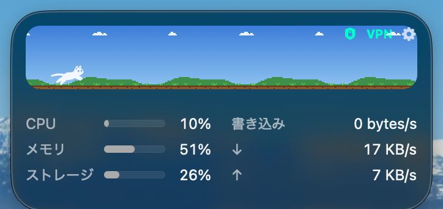
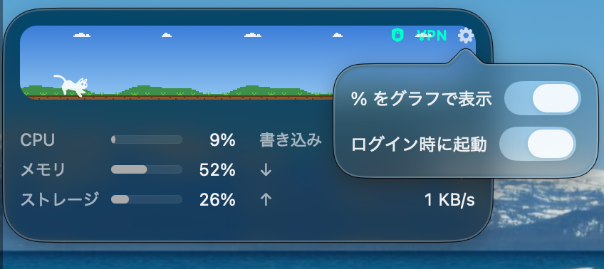

# DeskRunner

macOS のデスクトップに置く、猫が平原を走るシステムモニタ。猫の速さは CPU 使用率で変わります。



## できること

- CPU・メモリ・ストレージの使用率、ディスク書き込み、ネットワークの送受信を 1 秒ごとに表示
- VPN 接続中は VPN 側の通信量を表示して「VPN」マークを付ける
- 標準のデスクトップウィジェットと同じ大きさ (中サイズ) と高さに置かれ、ドラッグして離すと近くのウィジェットの格子に揃う
  - Command を押したまま離すと揃えずにその場に置く
  - 標準ウィジェットと重ならない位置を選ぶ

## 必要環境

- macOS 26 以降
- Swift 6.2 以降 (ビルドする場合)

## ビルドとインストール

```sh
./Packaging/build-app.sh
cp -R dist/DeskRunner.app /Applications/
open /Applications/DeskRunner.app
```

署名はアドホックです。初回起動で警告が出た場合は Finder で右クリック →「開く」を選んでください。

## 設定

ウィジェット右上の歯車から開きます。



| 項目 | 内容 |
|---|---|
| % をグラフで表示 | CPU・メモリ・ストレージを横棒グラフでも表示する |
| ログイン時に起動 | ログイン項目に登録する。登録は今アプリがある場所に紐付くので、`/Applications` に置いてからオンにする。システム設定で許可を求められた場合は「一般 → ログイン項目」で許可する |

終了はウィジェットを右クリック →「終了」。

## 制限

- Finder のデスクトップアイコンはこのウィジェットを避けません (macOS が標準ウィジェットにしか提供していない仕組みのため)
- ウィジェットギャラリーからは追加できません (WidgetKit ではなく通常のウィンドウで実装しているため)

## クレジットとライセンス

DeskRunner 自体は [MIT License](LICENSE) です。次のプロジェクトのコードと素材を使っています。

- 猫の画像と走るアニメーションの仕組み: [RunCat Neo](https://github.com/runcat-dev/RunCatNeo) (Apache License 2.0, [LICENSE-RunCatNeo](LICENSE-RunCatNeo))
- デスクトップウィジェットの格子計算と標準ウィジェットの検出: [macterm](https://github.com/thdxg/macterm) (MIT License, [LICENSE-macterm](LICENSE-macterm))

DeskRunner は RunCat および RunCat Neo の開発元とは関係のない非公式のプロジェクトです。
